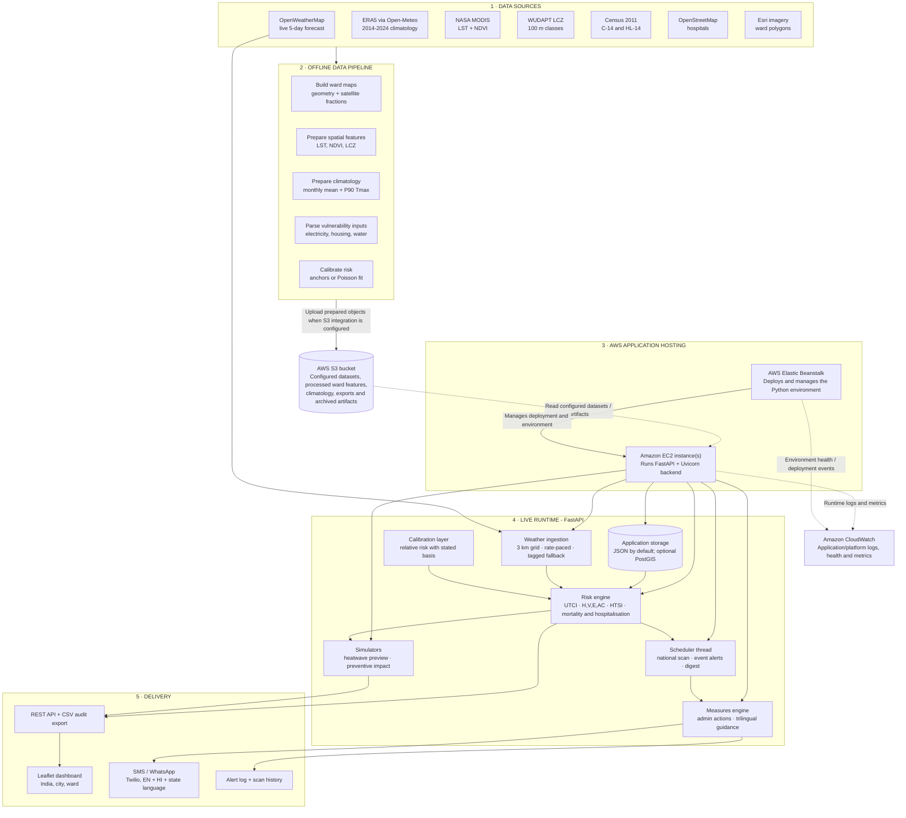
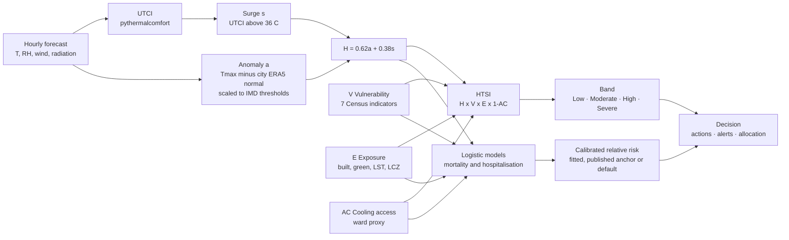
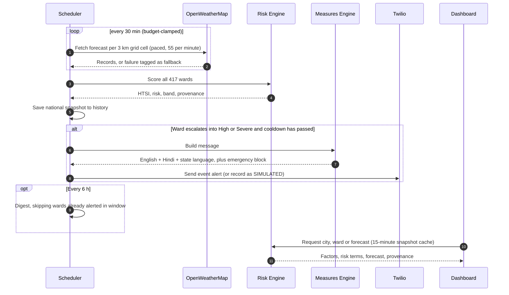

<div align="center">

# ThermaLens
### Thermal Assessment & Protection Analytics System

**A ward-level early-warning and decision-support system for extreme heat in Indian cities, using a Human Thermal Stress Index**


</div>


## Table of Contents

1. [Problem Statement](#1-problem-statement)
2. [Our Solution](#2-our-solution)
3. [Key Features](#3-key-features)
4. [How It Works](#4-how-it-works)
5. [System Architecture](#5-system-architecture)
6. [Tech Stack](#6-tech-stack)
7. [Data Sources](#7-data-sources)
8. [Pilot Coverage](#8-pilot-coverage)
9. [Getting Started](#9-getting-started)
10. [Project Structure](#10-project-structure)
11. [Transparency & Limitations](#11-transparency--limitations)
12. [Future Scope](#12-future-scope)
13. [Acknowledgements](#13-acknowledgements)

---

## 1. Problem Statement

Heatwaves are a major and growing climate-related threat in India. Many warning systems operate at the **district or city scale** and rely heavily on **air temperature**, leaving several important gaps:

- **Limited local detail.** Within a city, a densely built ward with little vegetation and limited cooling access may face substantially greater risk than a greener neighbourhood, even if both receive the same warning.
- **Temperature alone is insufficient.** Humidity, wind and radiant heat affect the body's thermal burden. As a result, similar air temperatures can produce different levels of physiological stress in different climates.
- **Warnings need to support action.** Alerts are more useful when paired with practical guidance for residents and authorities and communicated in locally relevant languages.

ThermaLens addresses these gaps by combining weather conditions with local environmental and population indicators to support ward-level heat-risk assessment.

---

## 2. Our Solution

**ThermaLens** estimates heat risk for each municipal ward by integrating current weather forecasts with information on urban form, population vulnerability and access to cooling. The resulting assessments are designed to inform timely warnings and response planning.

1. **Assesses thermal stress** using the Universal Thermal Climate Index (UTCI), which accounts for more than air temperature alone.
2. **Evaluates heat anomalies against city-specific seasonal conditions**, using an approach informed by India Meteorological Department (IMD) heatwave criteria.
3. **Calculates a ward-level score** using the **Heat–Health Stress Index (HTSI)**, which combines hazard, vulnerability, exposure and adaptive capacity.
4. **Provides model-based mortality and hospitalisation risk estimates**, with the mortality component informed by published epidemiological relative risks.
5. **Supports heat-action planning** by suggesting measures for authorities and residents and estimating their potential modelled impact.
6. **Supports automated alerts** through SMS or WhatsApp in **English, Hindi and the relevant state language**, including emergency guidance for High and Severe risk levels.

---

## 3. Key Features

| Feature | Description |
|---|---|
| **Thermal stress assessment (UTCI and HTSI)** | Estimates heat-related stress using physiological and environmental indicators. |
| **Ward-level GIS dashboard** | Supports navigation from country to city and ward, with risk, mortality, hospitalisation, UTCI and vegetation layers. |
| **Five-day ward forecast** | Displays daily peak HTSI, UTCI and risk categories; forecast confidence decreases with lead time. |
| **Automated alerts and city digest** | Sends deduplicated threshold-crossing alerts and a six-hourly summary with duplicate suppression. |
| **Multilingual guidance** | Provides English, Hindi and supported state-language guidance, with emergency numbers 112 and 108. |
| **Preventive-measure simulator** | Estimates the modelled change in risk associated with selected Heat Action Plan measures. |
| **Resource allocation support** | Ranks wards by modelled priority and suggests proportional resource deployment. |
| **Model transparency** | Reports probability contributions and identifies the source and provenance of inputs. |
| **Calibration layer** | Uses published relative-risk anchors for mortality and supports calibration against observed health data. |
| **Heatwave simulator** | Provides a clearly labelled, disabled-by-default scenario for demonstrations and preparedness exercises. |
| **CSV audit export** | Exports ward-level HTSI values, risk components and calibration basis. |
| **Configurable model** | Allows model weights, coefficients and risk thresholds to be adjusted at runtime. |

---

## 4. How It Works

### The Heat–Health Stress Index

```
HTSI = H × V × E × (1 − AC)
```

When each weight is set to 1.0, the expression reduces to the base index shown above. A configurable weighted form is:

```
HTSI = (wH · H) × (wV · V) × (wE · E) × (1 − wAC · AC)
```

| Factor | Question it answers | Built from |
|---|---|---|
| **H — Hazard** | How abnormal and how physiologically stressful is the heat right now? | Departure of daily Tmax from the city's ERA5 normal, scaled to IMD heat-wave thresholds (0 at normal → 0.5 at +4.5 °C → 1.0 at +6.4 °C), combined with UTCI surge above 36 °C |
| **V — Vulnerability** | Who lives here and how susceptible are they? | Census 2011: children 0–6, literacy, slum share, elderly 60+, disability, density, kutcha housing (real per ward from HL-14) |
| **E — Exposure** | How much does the built environment trap heat? | Satellite built / vegetation / water fractions, MODIS land-surface temperature anomaly, WUDAPT Local Climate Zones |
| **AC — Adaptive Capacity** | Can residents cool down? | City AC baseline modulated per ward by built density, NDVI, electricity and tap-water access, hospitals per km² |

HTSI is classified into **Low, Moderate, High or Severe** categories. Mortality and hospitalisation probabilities are generated by auditable logistic models using the same broad factors, alongside a relative-risk estimate compared with a normal day.

### Alert flow

```
Live weather ─► UTCI + anomaly ─► Ward HTSI & risk ─► Band crossing? ─► Event alert (trilingual SMS)
 └► every 6 h ────► City digest (cross-suppressed)
```

The detailed methodology, model coefficients and API reference are documented in **[TECHNICAL.md](TECHNICAL.md)**.

---

## 5. System Architecture

ThermaLens separates preparation of relatively static ward-level datasets from live forecast processing. The runtime combines these inputs with current weather data to estimate ward-level risk, generate alerts and serve the dashboard. In the AWS deployment, **Elastic Beanstalk** manages the application environment, **Amazon EC2** provides the compute capacity for FastAPI, **Amazon S3** stores datasets and generated artifacts when the relevant integration is enabled, and **Amazon CloudWatch** collects operational logs and metrics. Elastic Beanstalk provisions and manages the EC2 instances used by its environment.

### 5.1 Layered overview



### 5.2 Risk engine: from raw inputs to a ward decision



### 5.3 Runtime alert cycle



### 5.4 AWS deployment services

| AWS service | Role in the ThermaLens pipeline | Important implementation note |
|---|---|---|
| **AWS Elastic Beanstalk** | Deployment and environment-management layer for the Python 3.12 / FastAPI backend. It deploys application versions, configures the environment and reports environment health. | Use the managed Python platform with a `Procfile` to start the backend. Elastic Beanstalk manages the underlying EC2 capacity. |
| **Amazon EC2** | Compute layer on which the Elastic Beanstalk environment runs the FastAPI/Uvicorn application, weather ingestion, ward risk calculations, API endpoints and—while enabled—the in-process scheduler. | EC2 is provisioned/managed through Elastic Beanstalk. Keep secrets in environment configuration backed by a secrets service, rather than committing them to the repository. |
| **Amazon S3** | Object storage for prepared ward-level data, climatology, geospatial inputs, model/configuration artifacts, generated CSV exports and archived snapshots, where the application pipeline is configured to upload/read these objects. | Creating a bucket alone does not connect the existing JSON-based application to S3. Add and test an S3 storage adapter, configure a bucket environment variable, and grant the EC2 instance profile least-privilege access before describing S3 storage as active. Keep Block Public Access enabled. |
| **Amazon CloudWatch** | Central monitoring for Elastic Beanstalk environment health, EC2 metrics and application/platform logs; supports troubleshooting deployment failures, API errors, weather refresh problems and resource pressure. | Enable log streaming/retention in Elastic Beanstalk and configure alarms for unhealthy instances, elevated errors or resource utilisation. CloudWatch monitoring does not automatically persist application data to S3. |

**Deployment flow:** source code → Elastic Beanstalk application version → managed EC2 instance(s) → FastAPI endpoints. The backend can read/write S3 objects only after the S3 integration and IAM permissions are configured. CloudWatch receives logs and metrics from the deployed environment for monitoring and debugging.

### 5.5 Components

| Component | Responsibility | Where |
|---|---|---|
| **Datastore** | Loads ward polygons and merges satellite, HL-14, MODIS, LCZ and hospital data into one record per ward | `backend/datastore.py` |
| **Weather ingestion** | Pulls live forecasts per ~3 km grid cell, respects the 60/min limit, estimates shortwave radiation, tags any fallback | `backend/weather.py` |
| **Risk engine** | UTCI, anomaly, H/V/E/AC, HTSI, logistic mortality and hospitalisation, 5-day forecast | `backend/app.py` |
| **Calibration layer** | Attaches a relative risk labelled *fitted*, *published-anchor* or *default* | `backend/calibration.py` |
| **Scheduler** | Refreshes weather, runs the national scan, fires deduplicated event alerts and the cross-suppressed digest | `backend/app.py` |
| **Measures engine** | Selects Heat Action Plan actions per band and renders trilingual guidance | `backend/measures.py`, `measures_i18n.py` |
| **Simulators** | Labelled heatwave preview and preventive-measure impact scenarios | `backend/app.py` |
| **Storage adapters** | JSON by default, PostGIS geometry when `DATABASE_URL` is reachable | `backend/pg_store.py` |
| **Frontend** | Leaflet map, layer switching, ward panel, alert log | `static/` |

### 5.6 Design principles

- **Traceable inputs.** Data sources, dates and status labels (such as live, fallback, satellite or observed climatology) are retained and surfaced in the interface.
- **Graceful fallback behaviour.** Without a weather API key, the system uses a labelled demonstration series; without a database connection, it uses JSON storage; and without Twilio credentials, alerts are marked `SIMULATED`. Missing ward data is reported as "Insufficient data" rather than silently replaced by an average.
- **City-specific baselines.** Heat anomalies are evaluated against the relevant city's seasonal normal, using IMD criteria as a reference.
- **Auditable configuration.** Model contributions are exposed, while weights, coefficients and thresholds can be changed at runtime and persisted.
- **Runtime efficiency.** UTCI calculations are vectorised across wards, snapshots are cached in 15-minute intervals, and national scoring is repeated when weather data refreshes.
- **Deployment flexibility.** The application can run locally with Python or Docker Compose. For AWS hosting, Elastic Beanstalk manages the EC2 runtime; S3 and CloudWatch support storage and monitoring once configured.

---

## 6. Tech Stack

| Layer | Technology |
|---|---|
| **Backend** | Python 3.12, FastAPI, Uvicorn |
| **Scientific** | NumPy, Shapely, `pythermalcomfort` (UTCI) |
| **Modelling** | Custom logistic exposure–response models; Poisson GLM (IRLS) for calibration |
| **Frontend** | HTML, CSS, JavaScript, Leaflet |
| **Geospatial** | Ward polygons (GeoJSON), Esri World Imagery, MODIS via NASA GIBS, WUDAPT LCZ (COG) |
| **Database (optional)** | PostgreSQL 16 + PostGIS, with automatic JSON fallback |
| **Alerts** | Twilio SMS / WhatsApp |
| **Deployment** | AWS Elastic Beanstalk (managed Python platform), Amazon EC2 |
| **Object storage / monitoring** | Amazon S3 (configured datasets and artifacts), Amazon CloudWatch (logs, metrics, health) |
| **Testing** | pytest, Playwright |

---

## 7. Data Sources

| Layer | Source |
|---|---|
| Live weather & forecast | OpenWeatherMap |
| Climate baseline / thresholds | ECMWF ERA5 (2014–2024) via Open-Meteo |
| Heatwave criteria | India Meteorological Department (IMD) |
| Vulnerability | Census of India 2011 (C-14, HL-14); Sagar et al. 2016 (disability) |
| Land-surface temperature & NDVI | NASA MODIS Terra (MOD11A1, MOD13Q1) via GIBS |
| Local Climate Zones | Demuzere et al. 2022 (WUDAPT), Zenodo 6364594 |
| Urban form | Esri World Imagery, per-ward satellite analysis |
| Health-facility access | OpenStreetMap |
| Mortality relative risk | de Bont et al. 2024, *Environment International* 184:108461 |
| Action library | Ahmedabad Heat Action Plan |

---

## 8. Pilot Coverage

| City | State | Wards | Alert language |
|---|---|---|---|
| Mumbai | Maharashtra | 24 | Marathi |
| Ahmedabad | Gujarat | 48 | Gujarati |
| Chennai | Tamil Nadu | 201 | Tamil |
| Hyderabad | Telangana | 144 | Telugu |
| **Total** | | **417** | + English & Hindi everywhere |

The pilot cities represent distinct climatic settings: dry-hot conditions in Ahmedabad, humid coastal conditions in Mumbai and Chennai, and a semi-arid plateau climate in Hyderabad. Coverage can be extended by adding the required ward boundaries and preparing the corresponding input datasets.

---

## 9. Getting Started

### Try it online

The public URL will be added after the ThermaLens backend has been deployed to AWS Elastic Beanstalk and verified. Until then, the application can be started locally using the steps below.

### Run locally

```bash
git clone <repo-url> thermalens && cd thermalens
python -m venv .venv && source .venv/bin/activate
pip install -r requirements.txt

export OPENWEATHER_API_KEY=your_key_here # free tier is enough
python backend/main.py
```

Open <http://localhost:8000> in a browser. If no weather API key is configured, the application uses a clearly labelled demonstration weather series.

### Run with Docker (app + PostGIS)

```bash
export OPENWEATHER_API_KEY=your_key_here
docker compose up --build
```

### Environment variables

| Variable | Purpose |
|---|---|
| `OPENWEATHER_API_KEY` | Live weather (unset ⇒ tagged demo fallback) |
| `DATABASE_URL` | PostGIS (unset ⇒ JSON datastore) |
| `THERMALENS_S3_BUCKET` | Optional S3 bucket name; used only after an S3 storage adapter is implemented and configured |
| `TWILIO_ACCOUNT_SID`, `TWILIO_AUTH_TOKEN`, `TWILIO_FROM`, `TWILIO_TO` | Real SMS sends (otherwise honestly reported as `SIMULATED`) |
| `HW_LIVE_REFRESH_S` | Weather refresh interval in seconds (default `1800` = 30 min; auto-clamped to the OpenWeatherMap free-tier budget) |
| `HW_DIGEST_S` | City digest interval (default 6 h) |
| `HW_OWM_MONTHLY_LIMIT`, `HW_OWM_PER_MIN`, `HW_OWM_BUDGET_FRAC`, `HW_STALE_MAX_S` | Call-budget tuning: monthly quota (1,000,000), paced calls/min (55), planned share of quota (0.5), max age for reusing a last-good record (6 h) |

### Run the tests

```bash
pip install pytest httpx
cd backend && THERMALENS_NOSCHED=1 python -m pytest ../tests -q
```

> **Note:** If the backend code still checks the legacy scheduler-disable environment variable name, update that check to `THERMALENS_NOSCHED` before relying on this renamed test command. README branding changes alone do not rename environment variables inside the application code.

---

## 10. Project Structure

```
ThermaLens/
├── backend/ # FastAPI app, risk model, calibration, alerts, data pipeline scripts
├── static/ # Leaflet dashboard (index.html, app.js, styles.css)
├── data/ # Ward geometry, baselines, Census, MODIS, LCZ, calibration, weights
├── tests/ # Automated tests
├── scripts/ # UI regression check
├── Dockerfile
├── docker-compose.yml
├── README.md
└── TECHNICAL.md # Full methodology, API reference, pipeline and calibration guide
```

---

## 11. Transparency & Limitations

ThermaLens documents its current limitations and distinguishes model estimates from validated outcomes.

- **Decision-support scope.** ThermaLens is intended for heat-risk early warning and planning; it is not a clinical prediction system.
- **Mortality and hospitalisation estimates.** The mortality component uses published relative-risk estimates (de Bont et al. 2024) and has not yet been fitted to local observations. The hospitalisation model is also awaiting calibration; both can be refined when suitable observed data becomes available.
- **Unvalidated parameters.** Some coefficients are provisional defaults rather than empirically validated local estimates. This status is disclosed in the interface and API.
- **Ward-level comparisons require validation.** The model combines city-level Census 2011 information with ward-level satellite, HL-14 and OpenStreetMap inputs. City-level data may help calibrate overall risk but cannot independently validate differences between wards.
- **IMD absolute-temperature gate.** IMD heatwave criteria consider both departure from normal and an absolute maximum-temperature threshold (40 °C on the plains and 37 °C in coastal areas). ThermaLens scales positive temperature anomalies according to proximity to this threshold. Under the current configuration, the scaling factor rises from 0.25 at five degrees below the threshold to 1.0 at the threshold. This is intended to reduce the chance that a relatively mild day is classified as a heatwave solely because it is warmer than a cool-season normal. The behaviour is controlled by `imd_abs_gate` in `/api/weights`. The five-degree ramp and 0.25 floor are unvalidated defaults; because the floor is non-zero, wards may still be ranked relative to one another on cooler days. Mumbai and Chennai are currently listed in `COASTAL_CITIES`.
- **Seasonal adjustment.** For mortality and hospitalisation estimates, baseline ward factors (exposure, vulnerability uplift and cooling access) are scaled according to how close the month's ERA5 normal maximum temperature (2014–2024) is to the city's hottest month, with a minimum factor of 0.25. This is intended to limit persistently elevated risk categories outside the hot season. Strong heat anomalies or UTCI values around 44 °C and above override the seasonal adjustment. HTSI itself is not changed by this factor. The minimum factor and enable/disable option are controlled by `season_floor` and `season_enabled` in `/api/weights`; these remain unvalidated defaults.
- **Missing-data handling.** Missing values are reported as "Insufficient data"; any fallback values are explicitly labelled.
- **Scenario simulations.** Simulator outputs are labelled, and the simulator is disabled by default.

See [TECHNICAL.md](TECHNICAL.md) for the complete list.

---

## 12. Future Scope

- **Calibrate against observed health outcomes** by fitting mortality and hospitalisation models to suitable municipal death records and NCDC/IHIP heat-illness data.
- **Expand geographic coverage** to additional cities and incorporate IMD gridded forecasts and station observations.
- **Improve satellite inputs** with higher-frequency land-surface temperature products and cloud-free composites.
- **Update vulnerability indicators** as newer Census and survey datasets are released.
- **Community and field validation** using feedback from ward officials and health workers to evaluate and improve ward-level estimates.
- **Broaden alert delivery** through IVR, app notifications, community loudspeakers and additional regional languages.
- **Strengthen persistent storage** for alert histories and scan archives using PostGIS or an appropriate managed storage design.

---
<div align="center">


</div>
