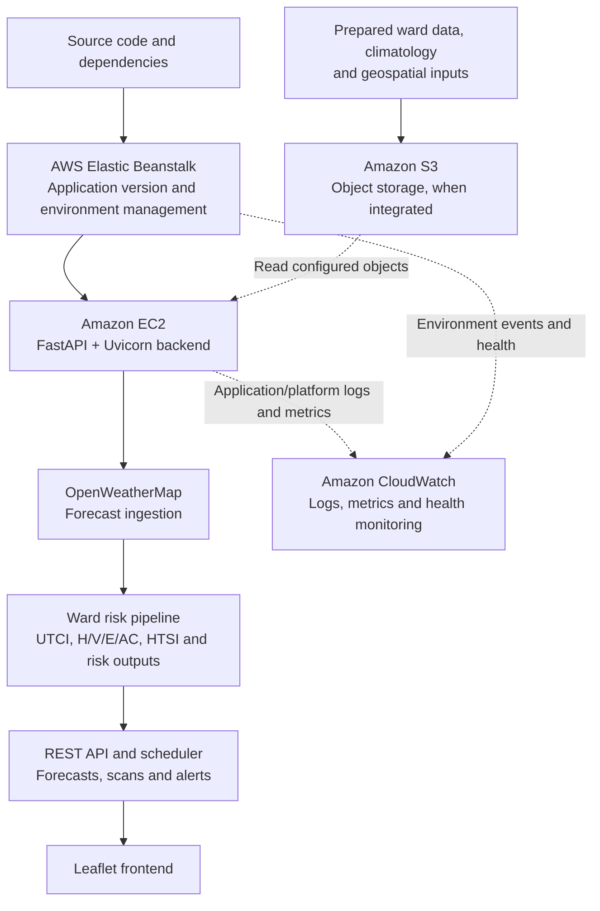

# ThermaLens — Technical Documentation

Thermal Assessment & Protection Analytics System. Ward-level heatwave early warning for Indian cities (Mumbai, Ahmedabad, Chennai, Hyderabad).

This document describes how the system works in the current codebase. Every coefficient marked **UNVALIDATED** is a manually specified default rather than a fitted or published value. Relevant source files are identified where useful.

---

## Contents

1. [System overview](#1-system-overview)
2. [Inputs and data sources](#2-inputs-and-data-sources)
3. [Core factors](#3-core-factors)
4. [Heat–Health Stress Index](#4-heathealth-stress-index)
5. [Mortality and hospitalisation risk](#5-mortality-and-hospitalisation-risk)
6. [Seasonal factor](#6-seasonal-factor)
7. [Calibration layer](#7-calibration-layer)
8. [Forecast](#8-forecast)
9. [Scheduler, alerts and caching](#9-scheduler-alerts-and-caching)
10. [API](#10-api)
11. [Testing](#11-testing)
12. [Known limitations](#12-known-limitations)
13. [Change log for this revision](#13-change-log-for-this-revision)

---

## 1. System overview

ThermaLens processes data through five main stages:

1. **Weather ingestion.** `weather.py` retrieves OpenWeatherMap forecasts and stores records by weather-grid cell.
2. **Static inputs.** `datastore.py` loads ERA5 climatology, satellite/MODIS/LCZ layers, Census and HL-14 tables, and OpenStreetMap hospital data.
3. **Ward-level assessment.** `compute_snapshot(city, ward)` derives the four model factors—Hazard (H), Vulnerability (V), Exposure (E), and Adaptive Capacity (AC)—for each ward.
4. **Risk outputs.** The model produces HTSI values and risk bands, modelled mortality and hospitalisation scores, optional calibrated relative risk, and a five-day forecast.
5. **Delivery.** FastAPI (`backend/app.py`) serves results to the frontend (`static/app.js`). The in-process scheduler (`Sched`) manages scans and alerts when enabled.

| Layer | Files |
|---|---|
| API and model | `backend/app.py` |
| Weather ingestion | `backend/weather.py` |
| Static data loading | `backend/datastore.py` |
| Calibration | `backend/calibration.py`, `backend/calibrate_risk.py` |
| Optional DB path | `backend/pg_store.py`, `backend/load_postgis.py`, `backend/sql/schema.sql` |
| UI | `static/index.html`, `static/app.js`, `static/styles.css` |
| Tests | Automated test suite under `tests/` |
| Local/container deployment | `Dockerfile`, `docker-compose.yml` (app + PostGIS; the app falls back to JSON if the DB is absent) |
| AWS deployment target | Elastic Beanstalk-managed EC2; S3 for configured object storage; CloudWatch for logs and metrics |

Run locally with `python backend/main.py`; the service listens on port 8000. For AWS deployment, use Elastic Beanstalk as the environment manager, with its managed EC2 instance running the backend. S3 and CloudWatch require the configuration described above.


### AWS deployment architecture

The deployment target uses AWS Elastic Beanstalk to deploy and manage the backend environment. Elastic Beanstalk provisions and manages the underlying Amazon EC2 instance or instances; EC2 is the compute layer that runs the FastAPI/Uvicorn application. Amazon S3 is intended for object storage of prepared datasets and generated artifacts once the application is configured to read and write those objects. Amazon CloudWatch provides operational visibility through environment health, logs and metrics.



| Service | Role in the pipeline | Configuration considerations |
|---|---|---|
| **AWS Elastic Beanstalk** | Deploys application versions and manages the backend runtime environment, including instance provisioning and environment health. | The Python platform can start the service through a root-level `Procfile`. Confirm the command and health check match the deployed application. |
| **Amazon EC2** | Runs the FastAPI/Uvicorn process, weather ingestion, ward-level risk calculations, API routes and—if enabled—the in-process scheduler. | EC2 instances are managed by Elastic Beanstalk in this architecture. Attach a least-privilege instance profile for any S3 access; do not embed credentials in source code. |
| **Amazon S3** | Intended to store prepared ward datasets, climatology, geospatial inputs, model/configuration artifacts, CSV exports and archived snapshots. | S3 integration is not automatic: the current JSON datastore will not start using a bucket just because one exists. Implement and test an S3 adapter, configure the bucket name, and grant the instance profile only the required permissions. Keep Block Public Access enabled. |
| **Amazon CloudWatch** | Collects application/platform logs and metrics and supports monitoring deployment health, backend errors, refresh failures and resource pressure. | Enable Elastic Beanstalk log streaming and set appropriate retention and alarms. CloudWatch monitoring does not itself persist application datasets to S3. |

**Current-state distinction:** Elastic Beanstalk, EC2, S3 and CloudWatch describe the target AWS deployment architecture. The repository documentation does not by itself prove that an AWS environment has been deployed, that S3 reads/writes are implemented, or that CloudWatch log streaming and alarms have been enabled. Treat S3 and monitoring integration as active only after they have been configured and verified.

---

## 2. Inputs and data sources

**Weather and climate**
- **Live weather:** OpenWeatherMap classic `/data/2.5/forecast` (free tier), in 3-hour steps for 5 days. Solar radiation is *estimated* from a clear-sky model scaled by cloud cover, and each such record is flagged `_sw_estimated`. If no API key is set, a labelled demo fallback series is used.
- **Weather grid:** wards are snapped to a 0.028° grid, and the wards in one cell share a weather record.
- **Climatology:** ERA5 reanalysis via the Open-Meteo archive, daily Tmax 2014–2024. Stored in `data/cities/<City>/baseline.json` as `mean_monthly_tmax` (the "normal") and `p90_monthly_tmax` (display only).

**Geography and environment**
- **Ward boundaries:** OpenStreetMap ward relations (`data/geo/*_Wards.geojson`, `data/cities/<City>/wards.geojson`). Hyderabad uses 144 wards from a 2017-dated extract (see section 12).
- **Land cover:** Esri World Imagery, thresholded on true colour to give `veg_frac`, `wat_frac` and `built_frac`. A rough proxy, not a land-cover product.
- **MODIS:** NASA GIBS, Terra. NDVI and daytime land-surface temperature per ward.
- **LCZ:** WUDAPT global Local Climate Zone map (Demuzere et al. 2022), giving a per-ward built share.

**People and services**
- **Census:** Census of India 2011 (city level) and HL-14 tables (ward level): population, children 0–6, literacy, slum share, elderly 60+, disability, density, kutcha housing.
- **Health facilities:** OpenStreetMap via Overpass (`amenity=hospital`), counted point-in-ward in `data/cities/<City>/health.json`.

**Health outcomes (optional)**
- **Published relative risks:** `data/observed/published_anchors.json`, used as priors in calibration.
- **Observed deaths and admissions:** `data/observed/observed.csv`. Enables fitting when there is enough data.

---

## 3. Core factors

### 3.1 Hazard, H

```
dep      = daymax − normal Tmax(month)              (°C)
a        = anomaly driver, 0..1 (see below)
surge    = clamp((UTCI − 36) / 10)
H        = clamp(0.62·a + 0.38·surge)
```

`UTCI` is computed with `pythermalcomfort`. Mean radiant temperature is `tair + 8·solar` between hours 6 and 18 (`+2` otherwise), where `solar = clamp(shortwave / 700)`. Wind is clamped to 0.5–17 m/s, and relative humidity defaults to 50% if missing.

**Anomaly driver `a` (`_a_of`)** follows the IMD heat-wave departure thresholds:

| Departure `dep` | `a` |
|---|---|
| ≤ 0 | 0 (or negative down to −1 at −6.4 °C if `sym_anom` is on) |
| 0 → 4.5 °C | 0 → 0.5, linear |
| 4.5 → 6.4 °C | 0.5 → 1.0, linear |
| > 6.4 °C | 1.0 |

### 3.2 IMD absolute-temperature gate

IMD requires both a departure of 4.5 °C or more and a hot absolute maximum (40 °C plains, 37 °C coastal) before declaring a heat wave. The original code checked only the departure, so a mild 33 °C day over a cool-month normal (for example Hyderabad in September, normal 28.8 °C) scored as a heat wave.

When `FLAGS["imd_abs_gate"]` is on (default), a positive departure is multiplied by:

```
g = 0.25 + 0.75 · clamp((Tmax − (threshold − 5)) / 5)      threshold = 40 (plains) or 37 (coastal)
```

So the factor is 0.25 at 5 °C below the threshold (and lower) and 1.0 at the threshold. The floor of 0.25 (`IMD_GATE_FLOOR`) is deliberate: a first version used a hard zero, which made H, and therefore HTSI, exactly 0 for every ward on any day when UTCI was 36 or below. That erased ward-to-ward ranking. With the floor, a +4.6 °C departure on a 33 °C day gives `a ≈ 0.13` instead of 0.53. Coastal cities are listed in `COASTAL_CITIES` (Mumbai, Chennai). The 5 °C ramp width (`IMD_GATE_RAMP`) and the floor are **UNVALIDATED**. Real heat waves (Tmax at or above the threshold) are unchanged.

The gate is applied at every call site of `_a_of`: current severity, snapshot, hourly and daily forecast, calibration features, the AC-uplift scenario, and the preventive-measures simulator.

### 3.3 Exposure, E

```
E = clamp(0.55·built + 0.45·max(0, 1 − veg − 0.6·water))
E ← 0.75·E + 0.25·clamp((LST − city median LST)/6 + 0.5)     if MODIS LST present
E ← 0.85·E + 0.15·LCZ built share                             if LCZ present
```

### 3.4 Vulnerability, V

A seven-indicator index (children 0–6, literacy, slum share, elderly 60+, disability, density, kutcha housing) weighted by `W_V` (defaults 0.22, 0.13, 0.18, 0.13, 0.09, 0.13, 0.12). Missing indicators are dropped and the weights renormalised.

```
V = clamp(0.92 + 0.30·index, 0.8, 1.32)        (V_SCALE lo = 0.92, hi = 0.30)
```

Most indicators are city-level Census 2011 values. Kutcha housing is per ward from HL-14 where the ward matched, otherwise the city row is used. Hyderabad has no official C-14 city row, so its elderly share (0.068) comes from the Hyderabad district row of C-14 Andhra Pradesh and is labelled as such. The index-to-V mapping is **UNVALIDATED**.

### 3.5 Adaptive capacity, AC

```
AC = clamp(city_base × mod, 0.05, 0.90)
mod = 1 − 0.18·Δbuilt + 0.16·Δgreen + 0.16·Δelectricity + 0.10·Δhealth + 0.08·Δwater
```

Each `Δ` is the ward's deviation from the city median, normalised and clamped to [−1, 1]. City bases: Ahmedabad 0.42, Hyderabad 0.50, Chennai 0.55 (Mumbai in `datastore.py`). The bases and modifier coefficients are **UNVALIDATED**. AC is a proxy for cooling access, not survey data.

---

## 4. Heat–Health Stress Index

```
HTSI = (wH·H) × (wV·V) × (wE·E) × (1 − wAC·AC) × scale
```

With the default weights (all 1.0) this is `H × V × E × (1 − AC)`. HTSI is clamped and banded by `BAND_T`:

| Band | HTSI |
|---|---|
| Low | < 0.055 |
| Moderate | 0.055 – 0.115 |
| High | 0.115 – 0.185 |
| Severe | ≥ 0.185 |

The national heat-watch panel, city peak band and alert flow all use the HTSI band.

---

## 5. Mortality and hospitalisation risk

Two logistic models on the same weighted factors:

```
z = intercept + c_anom·a + c_surge·surge + c_H·Hw
              + s·[ c_E·Ew + c_V·(Vw − 1) − c_AC·ACw ]
P = 1 / (1 + e^(−z))
```

`Hw, Ew, Vw, ACw` are the weighted factors used in HTSI. `s` is the season factor (section 6).

| Term | Mortality | Hospitalisation |
|---|---|---|
| intercept | −4.3 | −4.0 |
| anom | 3.0 | 3.2 |
| surge | 1.6 | 1.8 |
| H | 1.5 | 1.2 |
| E | 1.4 | 1.3 |
| V | 4.0 | 3.2 |
| AC | 1.8 | 1.4 |

All coefficients are **UNVALIDATED** defaults. Editable at runtime through `/api/weights`.

Risk bands from `RISK_BAND_T`: Low < 0.06, Moderate < 0.22, High < 0.45, Severe above. The HTSI and risk band scales are independent by design.

**Interpretation.** `P` is a relative, modelled score. It is not a forecast probability of death. The per-term contributions are returned in `factors.risk_terms` and sum to `z` within rounding.

---

## 6. Seasonal factor

The static ward terms (E, V, AC) applied all year, so dense low-cooling wards could read Moderate or High in cool months. The season factor scales only those three terms. The intercept and the live-hazard terms (`anom`, `surge`, `H`) are not scaled, and HTSI is unchanged.

```
rel      = (normal Tmax(month) − coolest month) / (hottest month − coolest month)
seasonal = floor + (1 − floor)·rel                       floor = 0.25 (default)
live     = clamp(max(2·a, (surge − 0.5)/0.3))
s        = max(seasonal, live)
```

- `live` restores full weight when the anomaly driver reaches heat-wave onset (`a = 0.5`), or when UTCI reaches about 44 (`surge = 0.8`). A sunny UTCI reading of 36–41 alone does not lift the season.
- If a city's monthly climatology is unusable (fewer than 12 months, or range under 1 °C), no season is applied and the reason is returned in `basis`.
- Applied in the snapshot, the 5-day forecast, the AC-uplift scenario and the preventive-measures simulator.
- Exposed in `factors.season` (per ward), `aggregate.season` (city), and `season_factor` on each forecast day.
- Settings: `season_enabled`, `season_floor` in `/api/weights`. The floor and the override thresholds are **UNVALIDATED**.

Example seasonal factors from the shipped climatology (`live` = 0):

| City | Jan | Mar | May | Jul | Sep | Nov |
|---|---|---|---|---|---|---|
| Hyderabad | 0.27 | 0.77 | 1.00 | 0.33 | 0.31 | 0.34 |
| Mumbai | 0.43 | 0.88 | 1.00 | 0.25 | 0.34 | 0.91 |
| Ahmedabad | 0.25 | 0.67 | 1.00 | 0.54 | 0.50 | 0.52 |
| Chennai | 0.26 | 0.65 | 0.98 | 0.86 | 0.70 | 0.32 |

---

## 7. Calibration layer

The calibration layer adds a relative-risk estimate versus a normal day alongside the logistic-model output; it does not modify the logistic score itself. Each result is labelled by its basis, in the following priority order:

1. **fitted** — Poisson count model on `observed.csv`. Requires at least 365 rows and 15 hot days (`a ≥ 0.25`).
2. **published-anchor** — slope anchored to a published relative risk (prior, not a fit).
3. **default** — the hand-set logistic only.

```
RR = exp(β_a·a + β_s·surge [+ γ·z_admissions])         capped at 4.0
```

Ward differences scale `(RR − 1)` by the ward's `V·E·(1 − AC)` multiplier relative to the city median. City data can calibrate the level of risk. It cannot validate ward-to-ward differences. An admissions feed older than 2 days is not used. Mortality is anchored to published results (de Bont et al. 2024). Hospitalisation is not calibrated.

Fit with `backend/calibrate_risk.py`, then `POST /api/calibration/reload`.

---

## 8. Forecast

For each ward, the five-day forecast uses three-hour forecast steps. UTCI is calculated in a vectorised operation, HTSI is derived for each step, and the daily peak is then selected. Per day it returns peak HTSI and band, peak UTCI, mortality and hospitalisation probability and band, `season_factor`, and a confidence value (1.0 within 24 h, 0.85 to 72 h, 0.62 to 96 h, 0.45 beyond).

Model confidence (`model_confidence`) blends factor confidences: weather 0.85 if live (0.60 mixed, 0.50 fallback), environment 0.70, vulnerability 0.35, AC 0.50.

---

## 9. Scheduler, alerts and caching

- **Refresh.** Weather refreshes every `HW_LIVE_REFRESH_S` seconds (default 1800). The interval is clamped to stay inside the OpenWeatherMap free tier (`/api/weather/budget`, `/api/cadence`). A failed refresh reuses the last good record until it is too old, then falls back.
- **National watch.** `Sched.at_risk()` recomputes all wards only when live weather actually refreshed, and caches the result between refreshes. This is why a model change does not appear until the next refresh.
- **Event alerts.** Sent on escalation to High or Severe. Cooldown: 6 h for High, 3 h for Severe.
- **Digest.** Periodic digest with cross-suppression, so wards already alerted within the window are not listed again.
- **Delivery.** Twilio SMS/WhatsApp if credentials are set. Otherwise sends are recorded in `data/outbox.jsonl` and labelled simulated.
- **Caches.** `_SNAP_CACHE`, `_V_CACHE`, `_MED_CACHE`. Cleared when `/api/weights` is posted.

---

## 10. API

**Views**
- `GET /api/cities`, `/api/india`, `/api/india/watch`, `/api/india/basemap` — city list and national heat-watch.
- `GET /api/city/{city}/wards` — ward properties, band distribution (`aggregate.distribution`), outlook and city `season`.
- `GET /api/city/{city}/geometry` — static ward geometry (cache it client-side).
- `GET /api/city/{city}/ward/{id}` — full ward snapshot: factors, `risk_terms`, `season`, calibration, forecast.
- `GET /api/trend` — 30-day trend.

**Scenarios and planning**
- `GET /api/city/{city}/ward/{id}/projection` — cooling-access (AC) uplift scenarios.
- `GET` / `POST /api/scenario/preventive` — preventive-measures simulator (illustrative).
- `GET /api/city/{city}/allocation` — wards ranked by modelled priority.
- `POST /api/sim` — labelled heat-wave simulator (temperature offset).
- `GET /api/city/{city}/export.csv` — per-ward audit export.

**Configuration and calibration**
- `GET` / `POST /api/weights` — read or change weights, coefficients, bands, flags and season. `reset: true` restores defaults.
- `GET /api/calibration`, `POST /api/calibration/reload` — calibration status and reload.

**Alerts and operations**
- `GET /api/outbox`, `/api/twilio/status`, and `POST /api/alerts/test` — alert delivery.
- `GET /api/weather/budget`, `/api/cadence`, `/api/db/status` — weather quota, refresh cadence and database status.

**Accounts and profiles (store-only v1)**
- `POST /api/auth/signup` / `POST /api/auth/signin` — demo local accounts (email + password, PBKDF2-HMAC-SHA256, `data/users.json`); returns `{token, user_id, email, profile, profile_complete}`.
- `GET /api/auth/me` (Bearer token), `PUT /api/auth/profile` `{location, age_range, ailments, ailments_note, consent_health_data}`, `POST /api/auth/signout`, `GET /api/auth/options` — profile enums + note.
- `GET /api/auth/alert` (Bearer) — personalized in-app ping: severity template (Low/Moderate/High/Severe) for the user's ward forecast, personalized line when 60+ or ailments apply, nearest hospitals only on Severe + personal risk. Twilio is not involved. `POST /api/auth/alert/preview {"band"}` renders any template on demand for testing/demo.
- Location: `{mode: geolocation|manual, lat, lon, accuracy_m, label, city, ward_id}`; geolocation sanity-checked to an India bbox, manual requires a locality label. Age range and ailments are optional; ailments require `consent_health_data: true`. Profiles are stored only — the risk engine, HTSI and guidance are unchanged in v1.

`POST /api/weights` fields added in this revision: `season_enabled`, `season_floor`, `imd_abs_gate`. Values persist to `data/weights.json`.

---

## 11. Testing

```
cd backend && THERMALENS_NOSCHED=1 python3 -m pytest ../tests -q
```

The command is intended to run offline, without weather-network calls and with the scheduler disabled. Recorded result in the source revision: **56 passed, 1 failed**.

Tests added: season bounds and peak/cool months, live-heat override, scaling of static terms only with `risk_terms` still summing to `z`, API switch and reset, city summary carries season, four tests for the IMD gate, and a regression test that HTSI is never exactly zero for every ward.

The recorded failing test, `test_configurable_risk_surface_and_reset`, was already failing in the documented source revision. It asserts `_a_of(−3.0) == −1.0` with `sym_anom` on, but the code returns −3/6.4 = −0.47 (the docstring says the value reaches −1 at −6.4 °C). Either the test or the formula needs updating.

---

## 12. Known limitations

**Data currency**
- Hyderabad ward boundaries (144) and population (6,731,790, Census 2011, 650 km²) are the old GHMC. GHMC was reorganised in December 2025 to 300 wards and split into three corporations in February 2026. The ward count and population displayed by the application are therefore out of date.
- Vulnerability inputs are Census 2011.

**Model status**
- Nearly all coefficients are unvalidated defaults. Ward-to-ward differences are modelled, not measured.
- Mortality and hospitalisation values are relative modelled scores, not clinical predictions.
- No local death or admission records are loaded by default.

**Inputs**
- Land cover comes from a true-colour threshold on a basemap image, not NDVI or an official land-cover product.
- Solar radiation is estimated, not measured.
- AC is a proxy built from satellite and Census signals.
- Hourly forecast steps compare each step's air temperature with the monthly normal of *daily maximum* temperature, so hourly anomalies are systematically conservative relative to the daily comparison.

**Configuration**
- Coastal versus plains for the IMD gate is a hard-coded list of two cities.
- The gate ramp (5 °C), gate floor (0.25), season floor (0.25) and live-override thresholds are unvalidated.
- The season factor is a smooth heuristic and does not model monsoon versus winter differences separately. A month is scored only by its normal Tmax.

---

## 13. Change log for the documented revision

- **Season factor.** `SEASON`, `season_info`, `season_factor`, scaling in `_risk_terms` and `_risk_probs`, wiring into the snapshot, forecast, scenarios and simulator, new `/api/weights` fields, persistence, and a note in the city panel. Files: `backend/app.py`, `static/app.js`.
- **IMD absolute-temperature gate.** Added in `_a_of` and at all its call sites, with the `imd_abs_gate` flag. Files: `backend/app.py`.
- **Tests** cover the seasonal factor, the IMD gate and the no-all-zero regression; they are maintained in the `tests/` directory.
- **Documentation.** Formula, seasonal-factor and IMD-gate details are recorded in `README.md` and this technical reference.
